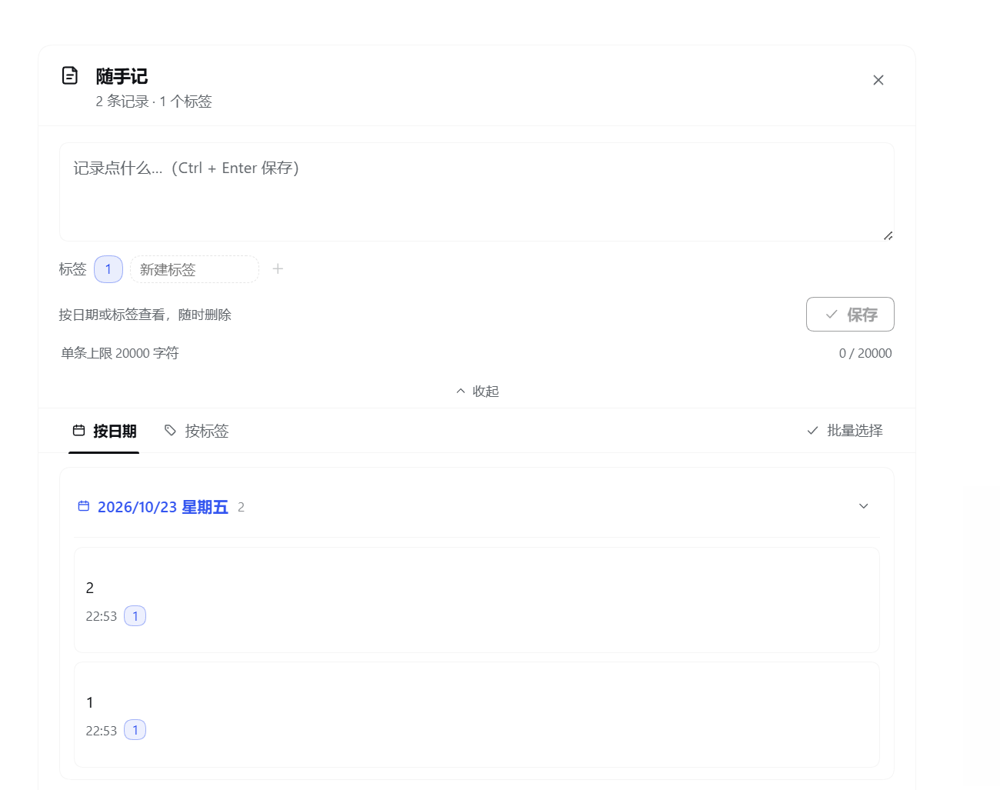

# dsh-simple-notes

> 可以随时记录自己的想法，可按日期与标签检索。

DeepSeek Harness 的侧边栏笔记本：点侧边栏图标随时打开，写完就存，既可以按日期翻看，也可以给自己建的标签翻看。



## 功能

- **随时记录**：侧边栏常驻入口，点开即写，支持多行文本
- **右键速记**：在侧边栏图标上点右键，弹出一个半宽的速记框，写完点保存即走，不用先打开整个面板
- **按日期检索**：按天分组，标题显示 `2026/10/23 星期五` 这样的实时日期
- **按标签检索**：自己建标签给笔记归类；还可以查看「未打标签」的笔记
- **批量操作**：进入批量选择后可勾选单条、整组或全选，然后合并、移动到指定标签、删除
- **编辑**：点开任意一条进入详情，修改后保存，原始创建时间保持不变
- **收起 / 展开**：每个日期或标签分组都能收起；收起后变成一条横向预览，右侧箭头可向右翻看，底部有横向滚动条
- **中文 / 英文界面**：跟随 Harness 的界面语言切换
- **本地保存**：笔记只存在本机，不上传任何服务器

## 安装

### 插件市场（推荐）

在 Harness 的插件市场搜索 `dsh-simple-notes`，一键安装。

### 命令行

```sh
dsh plugin --profile web add dsh-simple-notes
```

把 `web` 换成你自己的 profile 名即可。

DSH 桌面版请改用应用内的 **设置 → 插件** 安装：桌面版的 profile 由应用自己的插件管理器管理，命令行改动不会生效。

### 从源码

```sh
git clone https://github.com/ximiluoer/dsh-simple-notes.git
```

再用插件管理器把克隆下来的目录作为本地包安装即可，不需要构建。

安装后侧边栏会多出一个笔记本图标，点开就能用。

## 使用

1. 点侧边栏的笔记图标打开面板
2. 只想随手写一条时，在图标上点右键：弹出半宽的速记框，写完点「保存」即可收起
2. 在上方输入框里写内容，可顺手选中已有标签
3. 用「按日期 / 按标签」两个页签切换浏览方式
4. 点任意一条记录进入详情，可编辑、可删除
5. 点「批量选择」后可多选，再执行合并 / 移动至 / 删除

## 数据与隐私

- 笔记保存在本机 Harness 数据目录：`~/.dsh/.dsh-notes/notes.json`
- 同时会在浏览器 `localStorage` 里留一份镜像，接口不可用时仍能读到内容
- 除本机 Harness 自身的 `/dsh-notes/state` 接口外，插件不发起任何网络请求，也不会上传你的笔记
- 卸载插件不会删除已有的笔记文件

## 限制

- 单条笔记最多 20000 字符
- 最多 100 个标签
- 最多 5000 条笔记（宿主侧上限）

## 开发

无需构建步骤，改完文件后通过 profile 的插件管理重载即可生效。

| 文件 | 作用 |
| --- | --- |
| `index.js` | 宿主侧插件：提供 `GET/POST /dsh-notes/state` 读写笔记 |
| `client.js` | 前端界面：Cordis 客户端插件，用 `React.createElement` 手写渲染 |
| `cordis.patch.yml` | 把插件注册进 Harness 组合 |
| `locale/zh.json`、`locale/en.json` | 中英文文案 |
| `icon.svg` | 侧边栏图标 |

## License

MIT

---

## English

A sidebar notebook for DeepSeek Harness. Jot down ideas any time, then browse them by date or by your own tags.

- Grouped by date (`2026/10/23 Friday`) or by tag, switch with one click
- Batch select a single note, a whole group, or everything — then merge, move to a tag, or delete
- Edit any note in its detail view; the original creation time is kept
- Collapse a group into a horizontal preview strip with a right-arrow pager
- Chinese and English UI, following the Harness locale
- Notes stay on your machine: `~/.dsh/.dsh-notes/notes.json`, no network calls besides the local Harness endpoint

Install from the Harness plugin market, or:

```sh
dsh plugin --profile web add dsh-simple-notes
```

MIT licensed.